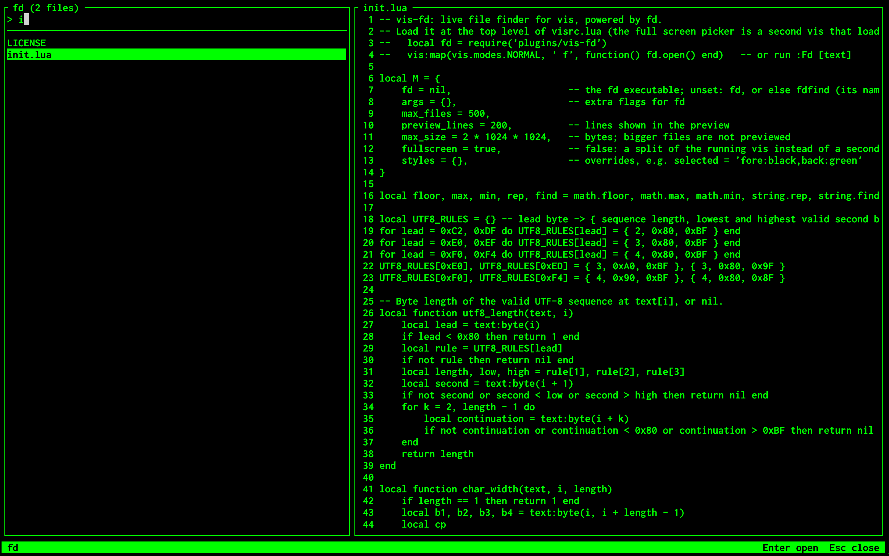

# vis-fd

A full-screen live file finder for [vis](https://github.com/martanne/vis), powered by [fd](https://github.com/sharkdp/fd). The vis port of [fd.vim](https://github.com/Solver42/fd.vim).



Why use vis-fd?

- **Speed** — fd runs in the background on every keystroke, so vis never blocks while you type.
- **Focus** — One prompt, one list, one preview. No fuzzy scoring or ranking to second-guess: the query is a literal substring and the results are sorted by path.
- **Simplicity** — One Lua file. No package manager. No dependency besides fd.

## Requirements

- [fd](https://github.com/sharkdp/fd)
- [vis](https://github.com/martanne/vis) built with Lua 5.3+ support
- A Unix terminal (the full-screen picker uses `/dev/tty`; without it you get a split)

## Install

Put this directory in `~/.config/vis/plugins/vis-fd` and load it from your `visrc.lua`, at the top level so it runs when vis starts:

```lua
local fd = require('plugins/vis-fd')
```

## Usage

- **:Fd** opens the picker in the current directory
- **:Fd {text}** opens it with an initial query
- **Type** to filter, **Backspace** or **Ctrl+H** to delete
- **Ctrl+N**, **Ctrl+J** or **Down** select next file **Ctrl+P**, **Ctrl+K** or **Up** select previous file
- **Ctrl+D** or **Ctrl+F** scroll preview down **Ctrl+B** or **Ctrl+U** scroll preview up
- **Enter** or **Ctrl+Y** open the file
- **Esc** or **Ctrl+C** close

To open the picker with a key, map it in `visrc.lua`:

```lua
vis:map(vis.modes.NORMAL, ' f', ':Fd<Enter>')
```

## How it works

The picker fills the whole screen. vis can't draw popups or resize its windows, so it runs in a second vis that has the terminal to itself, the way fzf is used from an editor, and hands the chosen file back. The left pane lists all files that match, the right pane shows a preview of the highlighted file.

The query is a literal substring, matched against the file name. A query that contains a `/` is matched against the whole path instead. It is smart-case: case-insensitive unless the query contains an uppercase letter. With an empty query every file is listed.

Only regular files are listed, sorted by path. Like fd itself, it skips hidden files and anything ignored by `.gitignore`, `.ignore` and `.fdignore`. Only the first 500 files are listed, and the title shows the total.

The preview shows the first 200 lines, and long lines are cut at the edge of the pane. Binary files, files that can't be read and files over 2 MB are not read, and the preview says so instead. Paths are resolved against vis's working directory.

The file opens in the window the picker was started from, like `:edit`. When that window has unsaved changes it opens in a split instead. vis takes a name that starts with `~` or contains any of `* ? [ { $` for a shell pattern and runs it, so such names are quoted first: `$(...)` does not run and `[id].tsx` does not open `i.tsx`.

Colours follow your theme. If fd fails, for example because of a bad flag in `fd.args`, its message is shown in the list.

## Configuration

Set these after the `require`. Pass extra flags to fd, for example to include hidden files but not `.git`:

```lua
fd.args = { '--hidden', '--exclude', '.git' }
```

You can change how many files are listed:

```lua
fd.max_files = 1000
```

You can change how many lines the preview shows:

```lua
fd.preview_lines = 100
```

You can change the size in bytes above which files are not previewed:

```lua
fd.max_size = 1048576
```

You can override a colour (`selected`, `lineno`, `sep`, `info`, `prompt`) with a vis style string:

```lua
fd.styles.selected = 'fore:black,back:green'
```

You can use a split of the running vis instead of the full screen, which takes half of it:

```lua
fd.fullscreen = false
```

fd is looked up as `fd`, then as `fdfind`. To use another executable:

```lua
fd.fd = '/opt/bin/fd'
```

The full-screen picker finds the running vis by itself on Linux. Elsewhere it starts `vis` from your `PATH`; to use another one:

```lua
fd.vis = '/opt/bin/vis'
```
